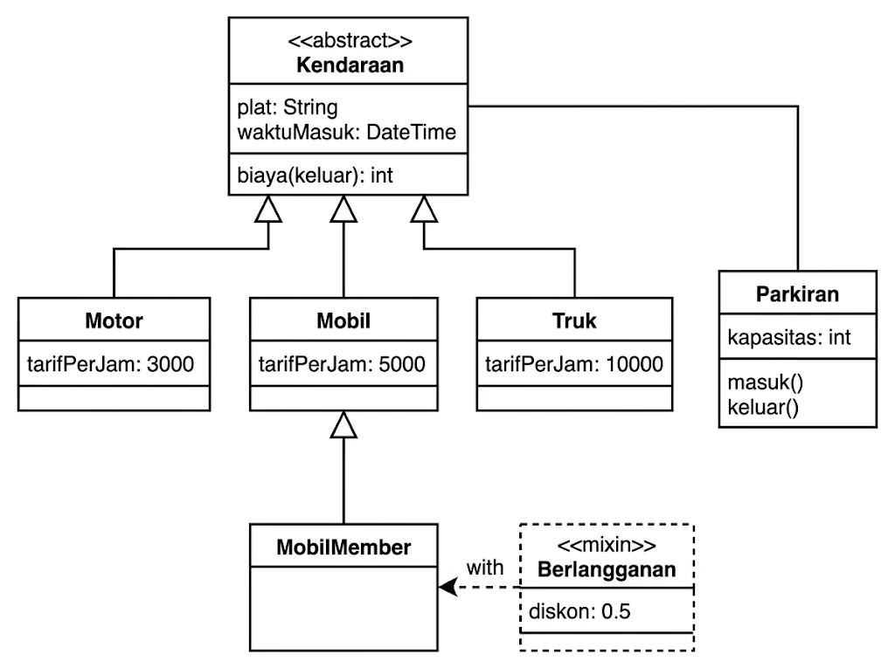
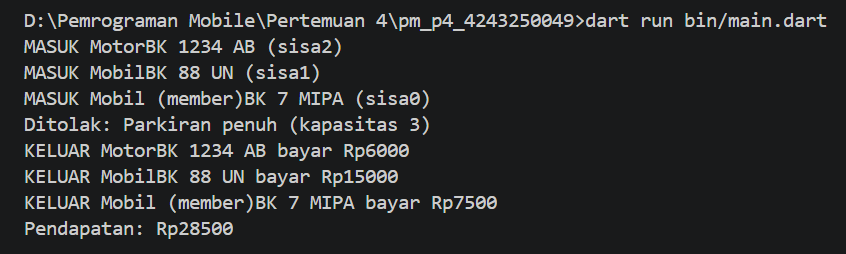

# Tugas Rutin 4 — Sistem Parkir Kampus (Console)

## (a) Identitas Mahasiswa
Nama    :   Angelina S. Saragih
NIM     :   4243250049
Kelas   :    PSIK 24C

## (b) Diagram Kelas Sederhana

## (c) Tangkapan Layar Keluaran

## (d) Penjelasan Penerapan Enkapsulasi, Polimorfisme, dan Async
Pada sistem parkir ini, enkapsulasi diterapkan di dalam kelas Parkiran (lib/parkiran.dart) dengan menjadikan daftar kendaraan terparkir (_terparkir), total pemasukan (_pendapatan), dan controller stream (_kejadian) bersifat privat menggunakan awalan garis bawah. Kode utama di bin/main.dart tidak dapat mengubah jumlah pendapatan atau memanipulasi isi parkiran secara langsung, melainkan harus melalui method resmi masuk() dan keluar(), sedangkan sisa slot hanya dapat dibaca melalui getter sisa.

Polimorfisme diterapkan ketika seluruh objek turunan (Motor, Mobil, MobilMember, dan Truk di lib/kendaraan.dart) disimpan dalam satu daftar bertipe List<Kendaraan>. Saat perhitungan biaya dilakukan pada proses keluar, Dart secara dinamis memanggil method biaya() sesuai jenis objek aslinya, termasuk menerapkan potongan diskon 50% dari mixin Berlangganan khusus pada kelas MobilMember.

Untuk asynchronous programming, method masuk() dan keluar() dirancang asinkron menggunakan Future, async, dan await dengan Future.delayed sebagai simulasi jeda palang pintu otomatis agar eksekusi utama tidak terblokir. Setiap transaksi yang berhasil langsung dipancarkan lewat StreamController.broadcast() dan ditampilkan secara reaktif oleh listener di pos jaga.

## (e) Pernyataan Penggunaan AI
Sebagian kerangka kode awal dan struktur dokumentasi pada tugas ini disusun dengan bantuan AI sebagai referensi belajar, kemudian disesuaikan, dijalankan, dan diverifikasi secara mandiri menggunakan dart analyze dan dart run bin/main.dart.